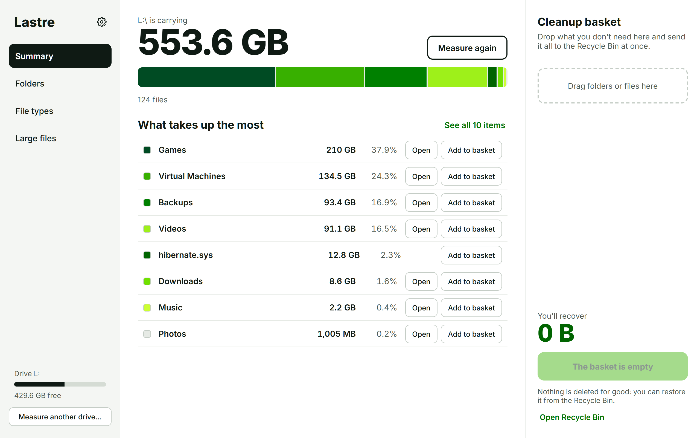
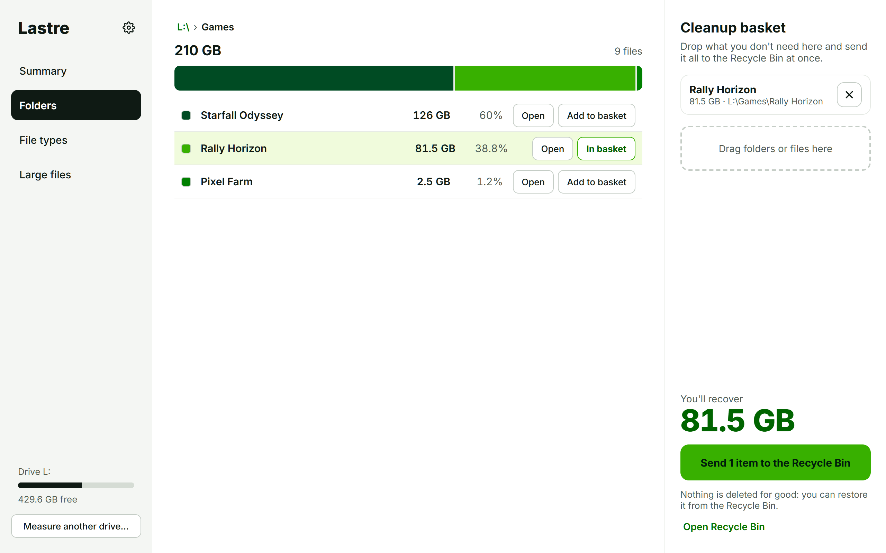
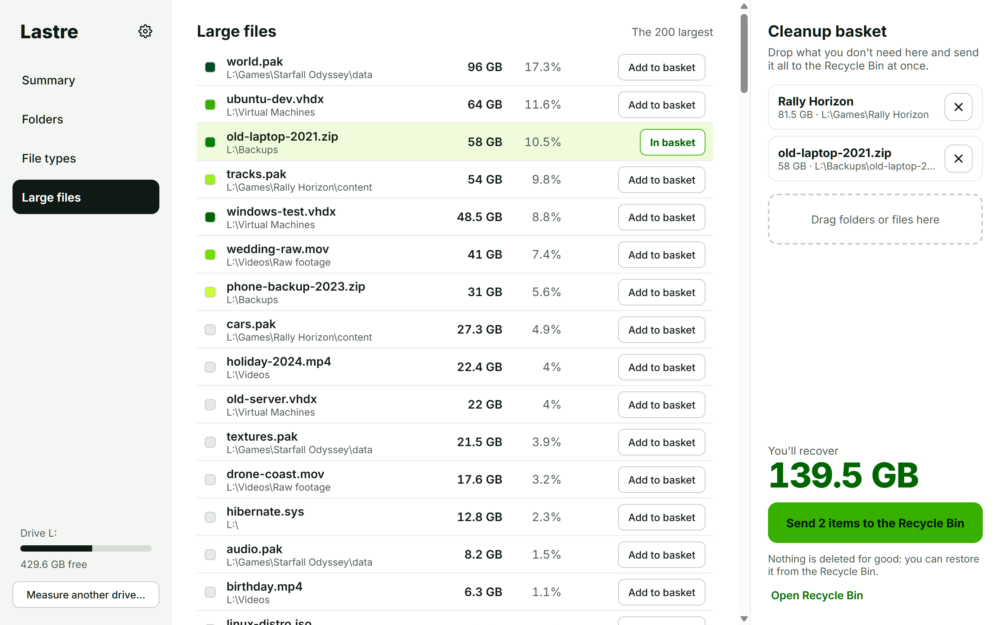
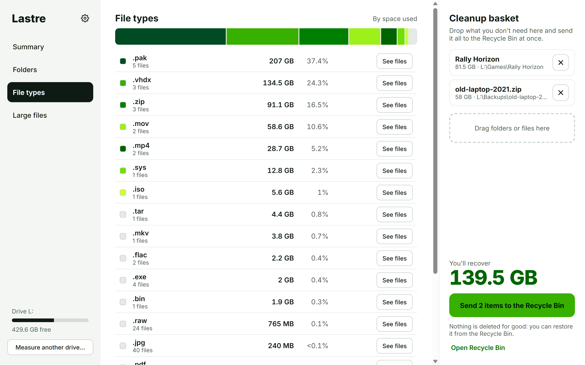
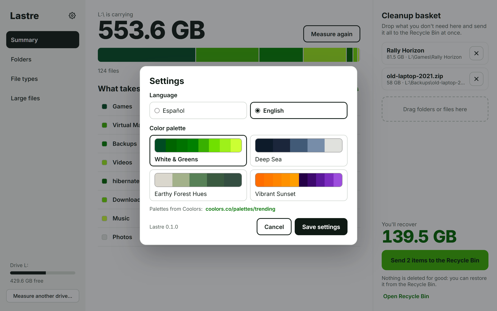

# Lastre

A disk usage analyzer for Windows built around one question: *what can I get rid of?*

Lastre ("ballast" in Spanish) measures a drive or folder, ranks what takes up the most space, and lets you collect anything you don't need in a cleanup basket that goes to the Recycle Bin in one step.

Built with Tauri 2 (Rust) and React + TypeScript.



## Download

Get the latest installer from the [Releases page](https://github.com/adridesweb/lastre/releases/latest): download `Lastre_x.y.z_x64-setup.exe`, run it, and open Lastre from the Start menu.

The installers are not code-signed yet, so Windows SmartScreen may warn the first time; choose **More info → Run anyway**.

## Features

- **Summary** — total size, a stacked bar showing how space is split, and the largest top-level items.
- **Folders** — drill down folder by folder, always sorted by size, with a clickable path.
- **File types** — space used per extension; jump from a type to its largest files.
- **Large files** — the 200 largest files in the scan, optionally filtered by type.
- **Cleanup basket** — add items with a button, by dragging rows, or from the right-click menu, then send them all to the Recycle Bin after a confirmation that lists every path. Nothing is ever deleted permanently.
- **Settings** — interface in Spanish or English and four color palettes.
- **Fast scanning** — a parallel Rust scanner; a 670 GB system drive with 3.2 million files takes about a minute and a half.

## Screenshots

| Folders | Large files |
| --- | --- |
|  |  |

| File types | Settings |
| --- | --- |
|  |  |

The screenshots use a demo folder, not a real drive.

## Building from source

### Requirements

- Windows 10 or 11 (WebView2 is included in Windows 11)
- [Node.js](https://nodejs.org) 20+ and [pnpm](https://pnpm.io)
- [Rust](https://rustup.rs): `winget install Rustlang.Rustup`
- MSVC Build Tools with the C++ workload: `winget install Microsoft.VisualStudio.2022.BuildTools`

### Getting started

```powershell
pnpm install
pnpm tauri dev      # run in development
pnpm tauri build    # build the app and installers
```

The build produces `src-tauri\target\release\lastre.exe` plus NSIS and MSI installers under `src-tauri\target\release\bundle`.

To measure a folder as soon as the app opens, pass it as an argument:

```powershell
lastre.exe D:\Games
```

### Tests

The scanner and the in-memory tree are covered by Rust unit tests:

```powershell
cargo test --manifest-path src-tauri\Cargo.toml
```

## Versioning and releases

Lastre follows [Semantic Versioning](https://semver.org/); changes are listed in [CHANGELOG.md](CHANGELOG.md). The current version is shown at the bottom of the Settings dialog.

To publish a new version:

1. Set the new version in `package.json` and `src-tauri/Cargo.toml` (the app and installers read it from `package.json`).
2. Add the version to `CHANGELOG.md`.
3. Commit, then tag and push: `git tag v1.2.3 && git push origin v1.2.3`.

Pushing the tag runs the [release workflow](.github/workflows/release.yml), which builds the installers and attaches them to a draft GitHub release to review and publish.

## How it measures

- Folders that can't be read without administrator rights are skipped and counted; the summary shows how many. Run Lastre as administrator to include them.
- Junctions and symbolic links are not followed, so nothing is counted twice through a link.
- Cloud-only files (OneDrive placeholders) count as 0 bytes because they take no disk space.
- Hard links (for example in `WinSxS`) are counted once per name, the same way File Explorer does.

## Project layout

```
src/                  React + TypeScript interface
  components/         Sections, item rows and the settings dialog
  i18n.ts             Spanish and English strings
  palettes.ts         Color palettes
src-tauri/src/        Rust backend
  scanner.rs          Parallel directory scanner
  tree.rs             Arena tree, size aggregation, largest files
  filetypes.rs        Per-extension statistics
  treemap.rs          Treemap layout and renderer (not used by the current interface)
  commands.rs         Tauri commands
```

## Credits

The color palettes are based on palettes from [Coolors](https://coolors.co/palettes/trending), including Deep Sea, Earthy Forest Hues and Vibrant Sunset; White & Greens is built on a Coolors green palette.
